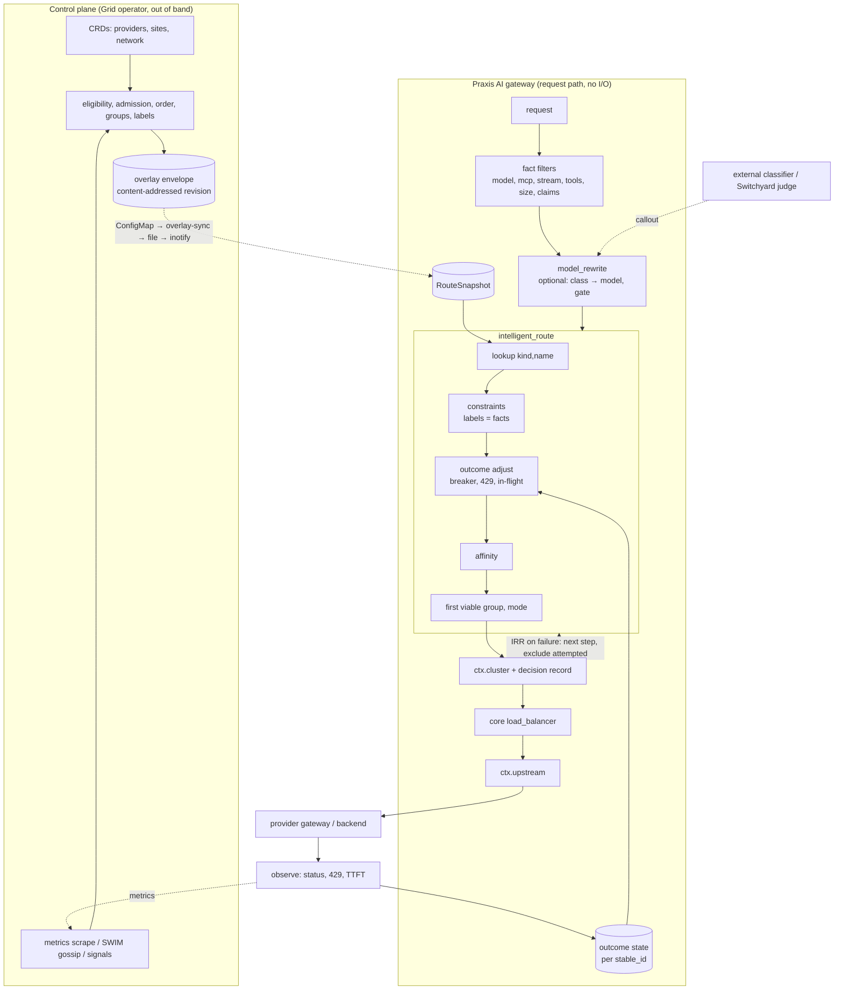

# Intelligent Router — Architecture & Requirements Analysis

Epic: [praxis-proxy/ai#74 Intelligent Router](https://github.com/praxis-proxy/ai/issues/74)

Status: analysis only. No production code was changed. Implementation
waits for review of this document.

Evidence base (all traced from code, not README prose):

| Repo | Commit | Date |
|---|---|---|
| `praxis-proxy/ai` (`ai:`) | `3b4533a8` | 2026-10-08 |
| `praxis-proxy/praxis` (`praxis:`) | `20ea6b91` | 2026-10-08 |
| `praxis-proxy/grid` (`grid:`) | `5078816` | 2026-10-08 |
| `praxis-proxy/experimental` | `main` | 2026-10-07 |
| `praxis-proxy/enhancements` | `main` | 2026-10-07 |

File references use the form `repo:path:line`. Line numbers are from the
commits above.

---

## 1. Executive Summary

The epic was written in May 2026 as a wish list. Since then the
foundational half of it shipped, mostly in Praxis AI and Grid, and the
ecosystem now carries **three separate routing implementations** plus two
delegation paths:

| Implementation | Where | What it decides on |
|---|---|---|
| `intelligent_route` | `ai:filters/src/routing/` | Grid-rendered overlay: ordered, grouped, admission-labelled candidates keyed by `(kind, name)`; local pick inside the first viable group |
| `grid_site_route` | `grid:gateway/ai-grid-filters/` | Operator serving config plus live per-site load polled every 5 s; measured availability, two-choices, prefix affinity, shedding |
| `switchyard_route` | `experimental` | LLM judge verdict → weak/strong tier → cluster and `model` rewrite, with a per-session floor |
| `ext_proc` + `endpoint_selector` | `ai:integrations/llmd/ext-proc`, `praxis:crates/filter/.../endpoint_selector.rs` | External EPP returns the endpoint |
| `iterative_request_router` + `router` | `praxis:crates/filter/.../iterative_request_router/` | Status-driven failover across static clusters |

The question is therefore not "which intelligent router do we build" but
"what is the one decision model these converge on, and which capability
belongs in which layer". The answer this document reaches:

1. **The architectural core already exists** and should be kept: a
   versioned, content-addressed candidate snapshot produced out of band
   (Grid), consumed by a filter that performs an O(groups) in-memory pick
   and writes exactly one thing, `ctx.cluster`, which Praxis core's
   `load_balancer` then turns into an endpoint
   (`praxis:crates/filter/src/context.rs:283`,
   `ai:filters/src/routing/picker.rs:17-33`). Nothing on the request path
   calls Kubernetes, Prometheus, or a peer.
2. **Two things are genuinely missing** and together unlock most of the
   epic without a new framework:
   - a *candidate constraint stage* between lookup and pick: candidates
     carry labels, request facts carry claims, and a fail-closed equality
     rule removes ineligible candidates. Issue ai#1282 describes it for
     entitlements; the same mechanism covers region lock, data residency,
     hardware class, tool capability, context window, and adapters;
   - *outcome feedback*: no response hook records upstream status or
     latency per candidate anywhere
     (`ai-signal-state-filters` §10); failover today is only control-plane
     withdrawal (minutes) or the body-buffering `iterative_request_router`.
3. **Model choice is a separate concern from backend choice.** Semantic,
   cost-cascade and mixture-of-models routing change *which capability*
   is requested; backend selection then routes that capability exactly as
   today. The shared piece is a small "rewrite `model` after a policy
   gate" filter (discussion praxis#838 converged on this), not a router.
4. **The largest accidental complexity is the dual gateway path**
   (`intelligent_route` versus `grid_site_route`) with two serving
   contracts and two selection semantics. Converging them is the single
   most valuable architectural decision in this epic and must be an ADR.
5. **Do not build**: an in-proxy embedding runtime, a policy DSL, a
   weighted multi-objective scorer in the gateway, a distributed routing
   control plane, prefix-cache radix trees in the gateway (Grid decided
   this belongs to llm-d EPP, grid#43), predictive forecasting, or MoE
   router training loops.

Recommended order: observability and contract hygiene (Phase 0) →
candidate constraints (Phase 1) → outcome feedback and in-request
failover (Phase 2) → path convergence (Phase 3) → model-choice layer
(Phase 4) → AI-specific long tail (Phase 5). Phases 1 and 2 are
independent and can run in parallel. Full table in §27.

---

## 2. Problem Definition

Praxis AI gateways front a mixture of self-hosted inference pools
(vLLM, llm-d), third-party APIs, and MCP/A2A agents, across clusters
and regions. A request names a *capability* (a model or a tool), not a
destination. The proxy must choose a destination that:

- can serve that capability (hard);
- the caller is entitled to and that satisfies compliance constraints
  (hard);
- is admitting new work right now (hard, time-varying);
- is preferable on locality, load, cost, or warmth (soft, time-varying);
- keeps related requests together when that matters (affinity);

and must keep doing so when a destination fails after selection, when
the control plane is absent, and without adding meaningful latency or
reading prompt content it should not read.

Everything in the epic is a variation on one of those bullets, or a
consumer of the decision (observability, metering), or a way of
changing the requested capability before the decision (semantic, cost
cascade, aliasing).

---

## 3. Epic Scope Analysis

Each epic section classified by what it really is. "Done" cites the
evidence found; details in §23.

| # | Epic section | Classification | State today |
|---|---|---|---|
| 1 | Content-based routing | Request facts (signals) | Model and MCP method done (`model_to_header`, `mcp`); `stream` promoted by format filters but unused by routing; tools/prompt-length/modality not started (ai#106/#107/#108) |
| 2 | Semantic routing | Capability choice (model rewrite) + external classifier | POC `switchyard_route` in experimental; nothing in `ai` |
| 3 | Cost-aware routing | Capability choice + budget policy | Cost parsed by Grid, weight always 0; budgets are ai#78; nothing routes on cost |
| 4 | Latency-aware routing | Outcome feedback (local) + control-plane signal | TTFT histogram per model only; no per-candidate history; grid#70 closed without a strategy |
| 5 | Pressure-based routing | Control-plane admission and ordering; gateway fast signal in poll mode | Done in Grid (`queueDepth`/`kvCachePressure`, admission hysteresis) and in `grid_site_route` (measured rho/ceiling, #319); not in `intelligent_route` |
| 6 | Prefix-cache-aware | Affinity (gateway) or EPP concern | Grid decided no operator strategy (grid#43); per-replica prompt hashing exists in `grid_site_route` (#287) |
| 7 | LoRA adapter routing | Capability naming + candidate labels | Adapters appear as model names via `/v1/models` discovery; no affinity/cold-load awareness |
| 8 | Phase-aware / P-D | llm-d EPP concern | Out of Praxis scope; Praxis routes to pools |
| 9 | GPU / accelerator | Candidate labels (constraint) | Only static `GridSite` labels via `siteSelector` |
| 10 | Session affinity | Affinity (process-local binding) | Done in `intelligent_route` (header/cookie, TTL); per-process only (grid#136); A2A context pinning done |
| 11 | Priority / criticality | Request fact + admission policy | Not started (ai#210); shedding exists in `grid_site_route` |
| 12 | Warm pool / cold start | Control-plane admission signal | Not started |
| 13 | Token counting / metering | Consumer of decision, separate epic | Done (ai#71 closed, `token_rate_limit`, `external_metering`) |
| 14 | Failover / fallback | Outcome feedback + retry mechanism | Only IRR with static `router` (`ai:examples/configs/inference/fallback-with-translation.yaml`); no cross-candidate retry |
| 15 | API translation | Separate epic (ai#363), consumer of decision | Mostly done; selected via `selected_upstream.application_protocol` conditions |
| 16 | Testing / rollout | Weighted split done; shadow/A-B need core mirroring | `weightedRandom` (ai#1068); praxis#318 mirroring not implemented |
| 17 | Batch vs real-time | Candidate labels + priority | Not started |
| 18 | Agent mesh | Separate epic (ai#148) | Partly done; keep out of router |
| 19 | Single-cluster routing | Baseline | Done |
| 20 | Multi-cluster routing | Done via Grid + provider boundary | Done (ai#197 status 2026-09-07); GIE CRDs not evidenced |
| 21 | Caching | Separate epic (praxis#42) | Not started |
| 22 | Security / compliance | Candidate constraints + classifier seam | Entitlement fence proposed (ai#1282); PII routing (ai#1120) kept separate by its author |
| 23 | Observability | Consumer of decision | OTel spans done; no routing metrics; no response transparency (ai#178) |
| 24 | Mixture-of-experts | Capability choice via external router model | `switchyard_route` POC; ai#758 declares it the MVP answer |

Three observations about the epic itself:

- **It conflates capability choice with backend choice.** Sections 2, 3,
  24 and half of 14 ("retry with model substitution") change the model.
  Sections 5, 6, 7, 9, 10, 20 choose where to send a fixed model.
  Treating these as one component is the main source of imagined
  complexity.
- **It lists llm-d EPP responsibilities as Praxis responsibilities**
  (sections 6, 8, parts of 5). Grid already recorded the boundary: "AGN
  provider selection is not llm-d pod selection"
  (`grid:docs/routing.md`), and grid#43 declined prefix-cache strategy.
- **Several items are already infrastructure consumed by routing, not
  routing** (13, 15, 18, 21, 23). They stay in their own epics.

---

## 4. Existing Architecture

### 4.1 Praxis core: where a routing decision can be made

The pipeline runs once per request in Pingora's `request_filter` hook.
A filter influences routing through two typed slots on
`HttpFilterContext`, never through headers:

- `ctx.cluster: Option<Arc<str>>` — set by any filter that declares
  `selects_cluster()` (`praxis:crates/filter/src/context.rs:283`,
  `filter.rs:89-99`);
- `ctx.upstream: Option<Upstream>` — set by `load_balancer`, or
  pre-set by `endpoint_selector`, in which case the LB skips selection
  (`praxis:crates/filter/src/builtins/http/traffic_management/load_balancer/mod.rs:323-338`,
  `endpoint_selector.rs:400-407`).

After the request phase the only revision point is Pingora's
`upstream_peer` hook, which on a retry asks `EndpointReselector` for
another endpoint **of the same cluster**
(`praxis:crates/protocol/src/http/pingora/handler/upstream_peer.rs:126-152`).
There is no cross-cluster failover on the proxy path; once a final
response header has been written downstream nothing is retried
(`with_body.rs:383-388`). The hedge policy merged on 2026-10-08
(praxis#1361) is configuration only; nothing fans out attempts
(`praxis:crates/core/src/config/hedge_policy.rs:66-88`).

Body-derived facts require the listener-wide `StreamBuffer` mode: the
whole body (bounded by `max_bytes`) is read to end-of-stream before the
request phase, copied once into a `BodyBuffer` and once into Pingora's
retry buffer (`praxis:crates/protocol/src/http/pingora/handler/request_filter/stream_buffer.rs:107-281`).
"Peek-then-stream" does not exist on the request side; `Release` during
pre-read is a no-op flag. Facts extracted from the body reach later
filters as promoted headers (`extra_request_headers`, resolved through
`pending_header_value`) or as `filter_metadata` strings (64-byte keys,
256-byte values, 128 entries, over-limit writes silently dropped,
`context.rs:34-65`).

The condition system (`when`/`unless`) matches path, method, headers,
and selected/bound upstream metadata; it cannot read `filter_metadata`,
query, client IP, or body (`praxis:crates/core/src/config/condition/request.rs:67`).
Control flow beyond conditions is `branch_chains` reacting to the
ephemeral `filter_results` map.

Backends: clusters are declared inline inside each `load_balancer`
filter; endpoints are static `host:port` with `weight`, a string
`metadata` map (used only by the config-time `subset` strategy),
`priority` and `zone` (`praxis:crates/core/src/config/cluster/endpoint.rs:31-56`).
Health is a per-process boolean per endpoint fed by active probes and
passive 5xx observation (`praxis:crates/core/src/health.rs:38-388`). No
per-endpoint latency, error rate, or EWMA exists anywhere; the only
per-endpoint metric is `praxis_upstream_requests_total`. Load-balancing
strategies take `(hash_key, health, exclude)` and nothing else
(`praxis:crates/filter/src/load_balancing/strategy.rs`); a filter cannot
constrain or re-weight the candidate endpoint set per request. Hot
reload rebuilds every pipeline and resets LB counters, retry budgets
and circuit breakers; only the unhealthy bit survives
(`praxis:crates/server/src/reload.rs:60-178,286-349`).

Process-wide state reachable from a filter and surviving reload:
`KvStoreRegistry` (string values, no TTL), `SessionStoreRegistry`
(sticky sessions), `HealthRegistry`, and arbitrary singletons injected
through `PipelineExtension::prepare` into `RequestExtensions`
(`praxis:crates/filter/src/pipeline/extension.rs:41-44`). The last is
the documented way for an out-of-tree crate to attach long-lived state.

### 4.2 Praxis AI: the production decision path

```text
client
  │
  ▼
json_body_field / model_to_header   body "model" → X-Model (client copy stripped)
  │
  ▼
intelligent_route                   lookup (kind,name) → groups → pick → ctx.cluster
  │                                 + x-ai-routing-{candidate,request-id,revision}
  ▼                                   for provider_hop_clusters
[credential_inject]                 final-hop credential from secretRef metadata
  │
  ▼
load_balancer                       cluster → endpoint (ctx.upstream)
  │
  ▼  mTLS, SNI <site>.grid.internal
provider gateway: peer_identity_trust → provider_route → credential_inject → load_balancer
```

`intelligent_route` reads one of two inputs: `mcp.method`/`mcp.name`
metadata from the `mcp` filter (precedence) or the configured model
header (`ai:filters/src/routing/intelligent_route.rs:922-974`). It never
reads the body. The decision is `select_candidate`: iterate producer
groups in number order, take the first whose admission is
`new_and_existing`, then pick inside it by `deterministic`,
`roundRobin`, `random`, or `weightedRandom`
(`ai:filters/src/routing/picker.rs:17-89`). Session affinity is checked
first and may reuse an `existing_only` candidate. Outputs are
`ctx.cluster`, ~15 `intelligent_route.*` metadata keys, hop headers, and
a `routing.select` span; no metrics, no response headers, no model
rewrite, no retry (`intelligent_route.rs:857-873,1108-1176`). Unknown
model or empty authoritative overlay → 404 without contacting any
upstream (ai#1039, ai#1539).

State: `Arc<ArcSwap<RouteSnapshot>>` swapped by an inotify watcher with
raw-hash and semantic-revision no-op detection
(`ai:filters/src/routing/overlay.rs:941-1240`); a per-process `DashMap`
of session bindings (≤10 k, lazy eviction). The module doc states the
invariant: "No request-time metrics or control-plane lookups are
performed" (`intelligent_route.rs:21-23`).

### 4.3 Grid: where the intelligence currently lives

Grid renders the overlay. Everything the epic calls "intelligent" is
computed there, out of band:

- eligibility: `gridNetworkRef`, provider phase, access policy,
  site selector, remote `GridSite` Active, readiness verdict, `!healthy`
  (`grid:docs/architecture/routing.md` "Routing eligibility");
- admission: `new_and_existing` / `existing_only` / `none` with
  hysteresis (`grid:operator/src/provider_admission.rs:80-315`);
- ordering: admission → locality tier → fresh → one-signal score
  (`grid:operator/src/resources/routing_overlay.rs:1440-1480`); only
  `queueDepth` or `kvCachePressure` ever has weight 1.0; cost, latency,
  locality and prefix weights are zero in every supported strategy
  (`grid:operator/src/crd/grid_network.rs:82-110`);
- groups: bumped on admission, freshness, or (geographyFirst) tier
  change; **score never splits a group** (grid#31 decision,
  `routing_overlay.rs:1143`);
- weights: static `capacityWeight` → `traffic_weight` under
  `weightedRandom`; dynamic weights are an experimental demo only
  (grid#169).

Cadence: reconcile every 300 s (60 s with TLS metrics). Remote metrics
ride SWIM/CRDT with no per-sample timestamp; freshness is SWIM member
state only. Withdrawal of a dead local backend takes up to the health
interval plus reconcile; pressure-driven `existing_only` only moves on
reconcile (`grid-control-plane` §6).

A second path exists since PRs grid#286/#287/#319: in `signalTransport:
poll` mode the operator renders a **serving config** and the gateway
runs `grid_site_route` instead, polling every site's operator signals
endpoint every 5 s over mTLS and ordering on live load with measured
availability, two-choices, optional shedding, and per-replica prefix
affinity (`grid:gateway/ai-grid-filters/src/`, 8 k lines;
`grid:charts/praxis-gateway/templates/_gateway-config.tpl:137-151`).
This path drops score, rank, tier, groups, weights and credentials from
what the gateway sees; it orders on load alone. The two paths therefore
embody opposite answers to "may the gateway compute on live signals".

### 4.4 Experimental: the model-choice path

`switchyard_route` buffers the body, calls an LLM judge through
`SubRequestClient`, maps the verdict to a weak/strong tier, rewrites the
`model` field and sets `ctx.cluster`, with `on_failure: open|closed`,
reuse of the last verdict per session, and a no-downgrade session floor
(`experimental:crates/praxis-experimental-filters/src/switchyard_route.rs`,
`config.rs`, `failure.rs`, `session.rs`). It is decision-only and
monolithic: classifier, tier policy, cluster choice and rewrite are one
filter with two fixed targets.

---

## 5. Existing Praxis Primitives

| Existing primitive | Current capability | Intelligent-routing reuse | Modification needed? | New abstraction needed? |
|---|---|---|---|---|
| `StreamBuffer` (request pre-read) | Full body buffered before request phase, two copies | Yes for any body fact (model, tools, stream, prompt size, modality) | No. Accept the cost; it is already paid by `model_to_header` on every inference listener | No. A "peek" mode would be a core feature with unclear payoff: the facts we need are near the top of the JSON but `serde` still needs a complete document |
| `json_body_field` / `model_to_header` | Promote top-level JSON fields to trusted headers | Yes; the canonical fact source for `model` | `model_to_header` could promote several fields in one pass (`fields:` already exists in core `json_body_field`) | No |
| `ai_operation`, format filters | Head-only operation id; body format, `stream`, `has_tools`, `max_tokens` | Yes as fact sources; today unused by routing | Fix ai#418 (custom promoted header names not stripped when body omits `model`) | No, but a written contract of which keys are routing inputs (§9) |
| `json_rpc` / `mcp` / `a2a` | Method, tool name, session/context ids | Yes; `mcp.name` already routes | No | No |
| `router` | Exact/prefix path, host, exact header equality → cluster | For management paths and static fallbacks only | No; do not grow it into a signal matcher (regex/weights are explicitly absent) | No |
| `load_balancer` | Endpoint pick inside a cluster, hash on header or path | Yes unchanged; the "endpoint" layer | No. Per-request candidate constraints belong above it (cluster level) | No |
| `endpoint_selector` | Trusted header → arbitrary `ctx.upstream` | Yes for EPP delegation | No | No |
| `branch_chains` + `filter_results` | Conditional sub-chains on a filter's result | Yes for coarse escalation (guardrail blocked, callout label) | No | No; avoid encoding routing policy as branch trees |
| `iterative_request_router` | Response-driven re-dispatch with per-step pipelines | Yes: the only cross-cluster failover mechanism | Small: `intelligent_route` must exclude candidates attempted in earlier steps (extensions persist across steps, metadata does not) | No |
| `circuit_breaker` | Per cluster name, per filter instance, 5xx counting | Partially; it is cluster-keyed, lost on reload, sees final status only | Prefer a per-candidate outcome record inside the routing state (§10) over stacking another filter | Yes, small: per-candidate outcome state |
| `guardrails` / `ai_guardrails` / `http_callout` | Pattern or external verdicts into `filter_results` | Yes as the classifier seam: a callout can label a request | `http_callout` results should optionally land in durable metadata or a promoted header so a later filter can read them (today only `on_result` exact match) | No |
| `credential_injection` / `credential_inject` | Per cluster or per secretRef credential | Yes unchanged | No | No |
| `rate_limit` / `token_rate_limit` | Request or token quotas; soft tiers inject upstream headers | Yes: over-quota tier header is a valid routing fact ("over tier → cheaper candidate") | No | No |
| `sticky_sessions` (core) | Cookie/header → endpoint pin | No for cluster-level affinity; `intelligent_route` already binds by `stable_id` | No | No |
| `trace_context`, OTel spans | `routing.select`, `provider.route` spans | Yes | Add routing metrics and a structured decision log (§20) | No |
| `KvStoreRegistry`, `PipelineExtension` | Reload-surviving process state | Yes as the home of outcome state and affinity bindings | `KvBackend` has no TTL; prefer a typed extension singleton | Yes, small: typed routing state singleton |

Where composition stops being appropriate: expressing candidate
eligibility as `router` header tables or branch trees. Every
combination of (tenant, region, hardware, model) would become a row;
Grid's consumer config already shows this cliff (overlay `cluster`
names must match a hand-written `load_balancer`, validated nowhere).
Eligibility needs data (labels on candidates), not more chain structure.

---

## 6. Capability Decomposition

Every epic bullet reduces to one of seven kinds of work. Each kind has
one home.

| Kind | Meaning | Home | Epic items |
|---|---|---|---|
| **Request fact** | A trusted, bounded string about this request, derived from head or body before routing | Fact-producing filters (`model_to_header`, format filters, `mcp`, `a2a`, identity, callouts) | model, stream, tools, prompt size, modality, priority, session key, tenant claims, classifier label |
| **Capability choice** | Changing which capability is requested (model substitution) | A small rewrite filter fed by a classifier or a cost policy | semantic routing, complexity tiers, cost cascade, aliasing, MoE router models |
| **Candidate metadata** | Static or slow-changing facts about where a capability can be served | Producer (Grid overlay, static config) as candidate labels | region, hardware class, provider, cost class, adapters loaded, batch/real-time pool, compliance tier |
| **Candidate state** | Time-varying admission and ordering | Producer (Grid) for minutes-scale; gateway outcome record for seconds-scale | health, queue depth, KV pressure, warm/cold, drained, recent failures, in-flight |
| **Constraint** | Hard rule removing candidates for this request | Constraint stage in the selection filter (label equality against facts) | entitlement, region lock, data residency, tools-capable, context window, adapter present, hardware |
| **Preference** | Soft ordering or spreading among eligible candidates | Producer order + groups; gateway mode within group; affinity | locality, cheaper, less loaded, warm cache, session stickiness, canary weights |
| **Consumer** | Uses the decision, does not make it | Separate filters/epics | token metering, API translation, observability, audit, cost attribution |

Items that are not Praxis work at all: phase-aware P/D routing, KV
transfer awareness, per-pod prefix radix trees (llm-d EPP);
cross-region DNS steering (GTM, `grid:docs/architecture/external-ingress.md`).

---

## 7. Dependency Graph

Derived from the code paths above, not from the epic's order.

```text
Trusted request facts  (model, mcp.name, stream, tools, size, claims)
        │
        ▼
Candidate snapshot  (producer: overlay file | static | serving config)
   kind, name, site, cluster, stable_id, admission, group, weight, labels*
        │
        ▼
Lookup (kind, name)  ──►  Constraint stage*  ──►  Group walk  ──►  Pick
                           labels vs facts         admission      mode, affinity
        │
        ▼
ctx.cluster  ──►  load_balancer  ──►  ctx.upstream  ──►  Pingora
        │
        ▼
Observe outcome*  (status, 429/Retry-After, TTFT, in-flight)
        │
        ├──► local candidate outcome state* (seconds)  ──► Constraint/Group walk
        └──► Prometheus / signals endpoint ──► Grid ──► next overlay (minutes)

Capability choice*  (classifier → policy gate → rewrite model) runs
BEFORE the snapshot lookup and only changes `name`.
```

`*` marks what does not exist today.

| Capability | Depends on | Enables | Complexity | Independent? | Phase |
|---|---|---|---|---|---|
| Routing decision metrics + structured log | metadata already written | safe rollout of everything else; ai#178, grid#13 | Low | Yes | 0 |
| Fact contract and anti-spoofing fixes (ai#418) | fact filters | every header-driven constraint | Low | Yes | 0 |
| Consumer-config / `deny_unknown_fields` reconciliation (ai#1494, grid `consumer_config.rs`) | — | operator-rendered consumer configs that actually load | Low | Yes | 0 |
| Candidate labels (overlay + static) | overlay schema minor bump | all constraints | Low | Yes | 1 |
| Constraint stage (`match` rules, fail-closed) | labels, facts | entitlement (ai#1282), region lock (grid#14), residency (ai#1120 v1), hardware, tools (ai#106), context window (ai#107), adapters, batch pools | Medium | Yes | 1 |
| `stream`/`tools`/prompt-size/modality facts | `model_to_header` multi-field or format filters | constraints above | Low | Yes | 1 |
| Per-candidate outcome state | `PipelineExtension` singleton; response hooks | temporary exclusion, 429 honoring, failover ordering, latency preference | Medium | Yes | 2 |
| Cross-candidate retry | outcome state; IRR; attempted-set exclusion | Failover section; "retry with model substitution" | Medium | Needs outcome state | 2 |
| Path convergence (`intelligent_route` ⊕ `grid_site_route`) | decision on ADR-002/003 | one serving contract, pressure routing in both modes | High | No | 3 |
| Shared affinity store (grid#136) | TTL KV trait + Valkey | multi-replica stickiness | Medium | Yes, if demanded | 3 |
| Model rewrite + policy gate filter | constraint stage (as the gate), facts | semantic, cost cascade, MoE, aliasing unification | Medium | Yes | 4 |
| Classifier seam (callout → fact) | `http_callout` durable output | semantic routing without in-proxy ML | Low | Yes | 4 |
| Cost tiers | ai#78 cost engine, rewrite filter | cost-aware routing | Medium | No | 4 |
| Priority / shedding (ai#210) | priority fact, outcome state or Grid admission | QoS (ai#145), batch segregation | Medium | No | 5 |
| Warm-pool awareness | Grid admission signal from `/api/ps` or readiness | warm-first routing | Low (Grid) | Yes | 5 |
| LoRA affinity | adapter as capability name + labels | adapter routing | Low | Yes | 5 |
| Shadow / A-B | praxis#318 mirroring | rollout section | High (core) | No | later |
| Hedging across candidates | praxis#1361 executor | tail latency | High (core) | No | later |
| Semantic cache, in-proxy embeddings, MoE training loop, forecasting | ai#175, praxis#42 | — | High | — | not now |

---

## 8. Core Routing Model

> An intelligent routing decision in Praxis is: given trusted facts about
> a request and a versioned snapshot of candidates, choose the first
> eligible candidate group and one member of it, record why, and let
> Praxis core bind the endpoint.

The minimum conceptual model that explains all requirements:

```text
Facts  ──►  [Capability choice]  ──►  Lookup  ──►  Constrain  ──►  Pick  ──►  Decision
            optional, rewrites name     (kind,name)   labels      group+mode   cluster + reasons
```

Five nouns, no more:

| Noun | Definition | Exists today as |
|---|---|---|
| **Fact** | `key → bounded string`, produced by a trusted filter before routing | promoted headers (`X-Model`), `filter_metadata` keys, `AuthenticatedIdentity` extension |
| **Capability** | `(kind, name)` requested | `CapabilityKind::{InferenceModel, McpTool}` + header value (`ai:filters/src/routing/descriptor.rs:44-50`) |
| **Candidate** | A place that can serve a capability: `site`, `cluster`, `stable_id`, `admission`, `group`, `weight`, plus **labels** (new) | `RouteCandidate` (`descriptor.rs:187-232`) |
| **Snapshot** | Versioned, atomically swapped candidate set with a selection policy | `RouteSnapshot` (`overlay.rs:367-398`) |
| **Decision** | `cluster` plus a bounded record of reasons | `intelligent_route.*` metadata + span |

Things deliberately **not** nouns: Signal, Scorer, Policy, Strategy,
Engine, Context. Signals are facts. Scoring happens in the producer.
Policy is three config fields (selection mode, constraint rules,
affinity) plus producer-side CRDs. A "RoutingContext" is
`HttpFilterContext`.

### 8.1 Hard versus soft

The distinction should exist architecturally because it already does
in the data: admission states and group boundaries are hard; order
within a group and weights are soft. The constraint stage adds a second
hard filter driven by the request rather than by the producer. Nothing
soft may remove a candidate; nothing hard may reorder one. This keeps
"why did my request get 404" answerable from the decision record alone.

### 8.2 Ordered rules, weights, or multi-stage?

Multi-stage filtering then ordered groups then one local mode. Reasons:

- weighted scoring across objectives (cost × latency × locality) is
  what Grid's `ScoringWeights::default()` offers and what production
  never uses; the supported API is one strategy at a time
  (`grid:docs/architecture/scoring.md` "Why Strategies Are Not
  Combined"). The team already judged multi-objective weights
  unexplainable; this document agrees;
- ordered rules (first match wins) are the `router` and would explode
  combinatorially (§5);
- priority levels are exactly selection groups.

---

## 9. Routing Signals

Facts that exist today and where they live. "Routing reads" marks what
`intelligent_route` or `grid_site_route` consume.

| Fact | Source filter | Carrier | Routing reads |
|---|---|---|---|
| model | `model_to_header` (strips client copy) | header `X-Model` | yes |
| MCP method / tool name | `mcp` | metadata `mcp.method`, `mcp.name` | yes |
| A2A context/task owner | `a2a` | header `x-praxis-a2a-route-cluster` | via core `router` |
| operation id, protocol | `ai_operation` | `x-praxis-ai-operation`, metadata | no |
| format, stream, has_tools, max tokens | `openai_responses_format`, `anthropic_messages_format` | `x-praxis-ai-{format,model,stream}`, metadata | no |
| tenant / subject | `identity_header_guard` (`identity.*` metadata), `state_owner` (`StateOwner` ext), auth (`AuthenticatedIdentity` ext) | three unreconciled carriers | no |
| session key | configured header or cookie | request | yes (affinity) |
| over-quota tier | `token_rate_limit` soft tiers | injected upstream header | via core `router` |
| guardrail verdict | `ai_guardrails`, `http_callout` | `filter_results` (ephemeral) | via branch only |
| request token estimate | `token_ceiling` (tiktoken) | not published | no |

Gaps:

1. **No single fact contract.** Three identity carriers, model in a
   header while format facts are metadata, callout results ephemeral.
   The constraint stage needs one lookup function `fact(key)` over a
   documented allowlist of sources (header or metadata), nothing more.
   This is a documentation and two-line-adapter task, not a framework.
2. **Spoofability** (ai#418): any fact used as a constraint input must
   be remove-then-set by its producer, as `model_to_header` and
   `ai_operation` already do.
3. **Prompt size, modality, tools** (ai#106/#107/#108): cheap to
   produce in the same pre-read pass that `model_to_header` already
   performs; `json_body_field` supports multiple fields. Prompt size as
   `content-length` or buffered byte length is sufficient for
   context-window overflow routing; tokenizing (`token_ceiling`) is not
   required for a routing fact.
4. **Classifier label** is just another fact from a callout. The
   `http_callout` filter must be able to write its extraction into
   durable metadata or a promoted header (today only `filter_results`),
   which is a small change in `ai:filters/src/callout/mod.rs:239-262`.

Facts must never include prompt content, only derived bounded strings.

---

## 10. Backend State

Classification of every state the epic implies.

| State | Scope | Consistency | Lives today | Should live |
|---|---|---|---|---|
| Candidate set, order, groups, weights, admission | cluster-level, per gateway perspective | eventually consistent, content-addressed revision | overlay (Grid → file → `ArcSwap`) | unchanged |
| Candidate labels (region, hardware, cost class, adapters, pool kind) | cluster-level, static | same as above | partly in CRDs, schema-only (`models[].capabilities`, `contextWindow`, `sovereigntyZone` unread; `grid-control-plane` §4) | overlay candidates + static config |
| Queue depth, KV pressure, readiness | per provider pool | eventually consistent, minutes (overlay) or 5 s (poll) | Grid admission/order; `grid_site_route` snapshot | producer, as admission and order; gateway only in poll mode (§17) |
| Measured availability, in-flight per candidate | per gateway process | process-local, seconds | `grid_site_route` only | gateway outcome state, applied within a group |
| Recent failures, 429 `Retry-After` per candidate | per gateway process | process-local | nowhere (core `circuit_breaker` is per cluster name per filter instance, reset on reload) | gateway outcome state |
| TTFT / latency history per candidate | per gateway process | process-local | nowhere (`praxis_ai_ttft_seconds{model}` only) | gateway outcome state (bounded EWMA), exported as metric; Grid may aggregate |
| Session → candidate binding | per gateway process (today); cross-replica (grid#136) | best effort | `DashMap` in `intelligent_route` | process-local; optional shared TTL store later |
| Prefix → site index | per gateway process | best effort | `grid_site_route` LRU | gateway; never the operator (grid#43) |
| Adapter inventory | per provider | eventually consistent | model discovery (`served_models.rs`) as model names | overlay candidate names and labels |
| Token quotas, budgets, spend | per tenant | strongly consistent across replicas | `token_rate_limit` Valkey; Grid `tenant_spend` never incremented (grid#69) | unchanged; a routing fact ("over tier") at most |
| Endpoint health | per cluster, per process | process-local | core `HealthRegistry` | unchanged |

Rules that follow:

- **Fail open on soft state, fail closed on hard state.** Missing or
  stale outcome state means "no adjustment", never "exclude". A missing
  or invalid snapshot means serve the last accepted one; an
  authoritative empty snapshot means 404 (ai#1539). A missing claim for
  a configured constraint means deny (ai#1282).
- **Staleness is explicit.** The overlay carries `rendered_at` and a
  revision; outcome state entries carry a timestamp and a short TTL;
  neither is used as a freshness-ordering key except through the
  producer's `fresh` flag.
- **No request-path I/O.** All state is `ArcSwap`, atomics, or a
  bounded `DashMap`.

---

## 11. Policies and Constraints

**Constraints (hard).** One rule shape covers every hard requirement in
the epic:

```yaml
# conceptual; not a proposed final schema
constraints:
  - fact: identity.region          # from the fact allowlist
    label: region                  # on the candidate
    missing: deny                  # deny | ignore
  - fact: ai.has_tools
    label: tools
    when: "true"                   # only applies when the fact has this value
```

Semantics: for each rule whose `when` matches, keep only candidates
whose `label` equals the fact value; `missing: deny` fails closed when
the fact is absent. Equality only. No operators, no expressions, no
precedence; rules are a conjunction. A fenced-out capability returns
the same 404 as an unknown one so nothing leaks (ai#1282). Affinity
reuse and weighted selection run on the constrained subset.

This is intentionally weaker than CEL (praxis enhancements 00191 is an
unresolved spike). If equality proves insufficient, add set membership
(`label` is a list), still not an expression language.

**Preferences (soft).** Three knobs only:

- producer ordering and groups (Grid policy: `geographyFirst` /
  `scoreFirst`, one scoring strategy);
- selection mode within the group (`deterministic`, `roundRobin`,
  `random`, `weightedRandom`);
- affinity (session key; prefix in poll mode).

Phase 2 adds one implicit preference: a candidate with an open outcome
breaker is skipped within its group as if `existing_only`, which is an
admission change computed locally rather than a score.

**Conflicts** between objectives resolve by construction: hard before
soft; producer order before local mode; affinity before mode; outcome
exclusion before affinity (a bound candidate that is failing is not
reused). The epic's "lowest cost vs lowest latency vs quality" conflict
is a *capability choice* question answered by the rewrite layer's
policy (§13.4), not by backend selection.

---

## 12. Routing Decision Model

Request lifecycle with ownership. Stages marked `*` are new.

| Stage | Responsibility | Inputs | Outputs | Failure | Latency budget | Owner |
|---|---|---|---|---|---|---|
| Pre-read | buffer body (bounded), run body filters | request | promoted headers, metadata | 413 over limit; invalid JSON per filter `on_invalid` | upload time; one copy | core |
| Facts | derive bounded facts | body, head, identity | headers/metadata per §9 | fail closed for required facts (400) | µs | fact filters |
| Capability choice* | optionally replace `model` | facts, class→model policy | rewritten body, `requested_model` fact | `on_failure: open` keeps original model | callout RTT when a classifier is used (bounded, optional) | rewrite filter |
| Snapshot load | `ArcSwap::load` | — | `Arc<RouteSnapshot>` | never fails; last-known-good | ns | selection filter |
| Lookup | `(kind, name)` → candidate list | snapshot | ordered candidates | 404 unknown | O(1) hash | selection filter |
| Constrain* | apply rules | facts, labels | eligible subset | 404 (fail closed), or `missing: ignore` | O(candidates × rules), tens of ns | selection filter |
| Outcome adjust* | local breaker/in-flight | outcome state | admission overrides | fail open (no adjust) | O(candidates) atomics | selection filter |
| Affinity | reuse binding | session key | candidate or none | fall back to pick | one `DashMap` get | selection filter |
| Pick | first viable group, mode | groups | candidate | 404 if none | O(groups) + O(log weights) | selection filter |
| Decide | write `ctx.cluster`, metadata, headers, span, metric | candidate | decision record | 500 if `stable_id` invalid | µs | selection filter |
| Bind endpoint | cluster → endpoint | health | `ctx.upstream` | 502 unknown cluster; panic mode | µs | core LB |
| Execute | Pingora proxy, in-cluster retry | — | response | per retry policy | — | core |
| Observe* | record status, 429, TTFT per candidate | response, `ctx.cluster_name()` | outcome state, metrics | never affects the response | sync `on_response_body`; atomics only | observe filter (or selection filter's response hook) |
| Re-dispatch* | on configured statuses, run next step excluding attempted candidates | IRR transitions | new decision | after max steps, last response | body replay from buffer | IRR + selection filter |

The two routing filters today implement rows 4-10 with different
internals; the convergence in §13 makes them one.

---

## 13. Proposed Architecture

### 13.1 Options compared

| Criterion | A. Extend existing `intelligent_route` | B. New dedicated Intelligent Router in front of existing routing | C. Generic signal → decision layer (policy engine) | D. Converge the three paths on one selection core with two narrow additions |
|---|---|---|---|---|
| Complexity added | Low | High (fourth router) | High (DSL, evaluator, contexts) | Medium, mostly deletion |
| Coupling | Unchanged | New contract between two routers | Every filter couples to the DSL vocabulary | Reduced: one snapshot type, one decision record |
| Extensibility | Labels + rules cover most hard needs | Unbounded, hence unexplainable | Unbounded | Bounded by design |
| Performance | Same hot path | Two decisions per request | Expression evaluation per request | Same hot path |
| Testability | Existing 250+ unit tests | New harness | Needs property tests on the language | Existing tests plus fixtures shared with Grid |
| Configuration | One filter, two new fields | Two filters to keep consistent | A language to learn | One filter, one serving contract |
| Compatibility | Full | Full | Full | Breaking for `grid_site_route` config (poll mode only) |
| Multi-cluster | Unchanged (Grid) | Unchanged | Unchanged | Improves: live-load adjustment in both modes |
| Operational | Unchanged | More to observe | Harder to debug | Fewer paths to observe |

**Recommendation: D, implemented as A plus one ADR.** Concretely:

1. keep `intelligent_route` as *the* selection filter and `RouteSnapshot`
   as *the* candidate model;
2. add a constraint stage (labels + rules) and an outcome-state
   extension to it;
3. fold `grid_site_route`'s live-load ordering, measured availability,
   shedding and prefix affinity into the same filter as an optional
   *snapshot adjuster* fed by the signals poller, so poll mode is a
   configuration of one filter rather than a second filter;
4. keep capability choice (semantic, cost, MoE) out of it: a separate
   `model rewrite` filter with a policy gate that reuses the constraint
   stage's data.

Option B is rejected because the ecosystem already has three routers;
adding a fourth "on top" multiplies contracts. Option C is rejected
because the hard requirements are equalities on labels and the soft
requirements are already a fixed vocabulary; an expression language
buys nothing the team has asked for and costs explainability, which
grid#31 and grid#43 both ranked above flexibility.

### 13.2 Mechanism versus policy

| Mechanism (code) | Policy (config / CRD) |
|---|---|
| buffer and extract facts | which facts are routing inputs (allowlist) |
| load and validate a snapshot | who produces it (Grid, static, serving poll) |
| equality constraint evaluation, fail-closed | which `fact`/`label` pairs apply |
| group walk, modes, affinity reuse | `selection_policy.mode`, affinity key, TTL |
| outcome recording, breaker thresholds | thresholds, `Retry-After` honoring on/off |
| IRR re-dispatch with attempted-set exclusion | which statuses trigger a next step |
| decision record and metrics | which fields reach access logs |
| model rewrite with original preserved | class → model map, allowed targets |

Grid owns the producer-side policy (`routingPolicy`, `scoringPolicy`,
`admissionPolicy`, `selectionPolicy`, labels on providers). Praxis owns
request-side policy (constraints, affinity, breaker thresholds, rewrite
map). No policy crosses that line as code.

### 13.3 Why this is not a policy framework

The configuration surface after all phases is: `constraints:` (list of
equality rules), `outcome:` (two thresholds and a TTL), `rewrite:`
(a map and a target allowlist). Each is a flat list of records with no
references between them. If a future requirement needs
"cost < X and latency < Y unless tenant is Z", the correct response is
to push that computation into Grid's producer-side ordering, where it
is evaluated once per minute with full information, not per request.

### 13.4 The model-choice layer

Discussion praxis#838 converged on `classify → validate/select →
rewrite`, each a filter. `switchyard_route` implements all three in one
unit with fixed weak/strong targets. The reusable pieces are:

- **classifier seam**: any filter that writes a bounded fact such as
  `ai.class = easy|medium|hard` or `ai.category = code`. Sources:
  `http_callout` to an external classifier (1-5 ms loopback per
  experimental#5), the Switchyard judge (a sub-request), or a static
  rule on facts (prompt size, tools);
- **policy gate + rewrite**: a filter that maps `(class, facts)` →
  target model from config, checks the target against the same label
  constraints the selection filter will apply (so a PII-tagged request
  cannot be rewritten toward an external model), rewrites only the
  `model` field, preserves the original in metadata and the existing
  `x-praxis-ai-original-model` / `x-praxis-ai-effective-model` headers
  (`ai:apis/src/promotion.rs:47`), and emits a reason. On classifier
  failure, `open` keeps the original model;
- **session floor**: the no-downgrade rule from `switchyard_route` is
  an affinity on the *class*, stored next to session bindings.

Rewrite happens **before** selection, so the existing selection filter
routes the rewritten model with no knowledge that a classifier ran.
This avoids depending on post-routing transformation (enhancements
00011) for the common case; 00011 remains the right hook for
"translate the body for the provider we chose" (API translation).

---

## 14. Information Hiding / Deep Modules Analysis

What each module hides, and what was challenged.

| Module | Hides | Interface | Verdict |
|---|---|---|---|
| Producer (Grid operator) | metrics sources, scrape cadence, SWIM/CRDT, hysteresis, geography, scoring, exclusion reasons | one JSON file with a revision | Deep. Keep. The single most important boundary (`grid:tasks/architecture-report.md` §1). |
| `RouteSnapshot` + watcher | file format versions, validation, atomic swap, no-op reloads, counter preservation | `snapshot.load()` | Deep. Keep. |
| Selection filter | constraint evaluation, group walk, modes, affinity, outcome overrides, decision recording | `on_request` → `ctx.cluster` | Deep today; grows by two stages without changing its interface. |
| Outcome state | thresholds, TTLs, atomics, reload survival | `record(candidate, outcome)`, `admission_override(candidate)` | New, small, deep: hides all time-series bookkeeping behind two calls. |
| Constraint stage | fact lookup across carriers, missing semantics, label matching | `eligible(candidate, facts) -> bool` | New, shallow-looking but justified: it is the one place that knows how facts are carried (§9 gap 1). |
| Model rewrite filter | JSON re-serialisation, original preservation, target validation, failure modes | config map; writes body and facts | New, deep enough; replaces three ad-hoc rewriters over time (`openai_responses_model_rewrite`, `llmisvc_model_provider_resolver`, `switchyard_route`'s rewrite). |
| Core `load_balancer` | endpoint health, hashing, retries, TLS | `ctx.cluster` → `ctx.upstream` | Deep. Unchanged. Must stay Grid-agnostic (grid#31). |

Challenged and removed:

- **A `RoutingSignals` struct** aggregating all facts: it would copy
  strings the filter already has access to and force every fact
  producer to know the struct. The allowlist plus `fact(key)` is enough.
- **A `Scorer` trait in the gateway**: would invite per-request
  multi-objective weights. Producer ordering plus group modes plus one
  local breaker is the whole soft surface.
- **A `BackendRegistry` in Praxis core**: core already has the health
  registry and cluster entries; the gateway needs per-*candidate*
  (cluster-level) outcome state, which is an AI-layer concern and fits a
  `PipelineExtension`.
- **A second serving contract** (`serving-config.json`): the overlay
  envelope already carries candidates; peers and poll settings are a
  small optional section, not a different document.
- **A `RoutingContext`**: `HttpFilterContext` is it.

---

## 15. Performance Considerations

What is synchronous on the request path, with cost, after all phases:

| Work | Cost | Note |
|---|---|---|
| Body pre-read for facts | one copy, bounded; upload latency | Already paid on inference listeners by `model_to_header`. Do not add a second buffering filter; extract all facts in one pass. |
| Snapshot load | one `ArcSwap` load | unchanged |
| Lookup + group walk | O(1) hash + O(groups) | unchanged (`ai:filters/src/routing/group_index.rs:45`) |
| Constraints | O(candidates × rules) string compares | candidates per capability are tens; rules single digits |
| Outcome overrides | O(candidates) atomic loads | no locks |
| Affinity | one `DashMap` get | unchanged |
| Observe | a few atomic adds in `on_response`/`on_response_body` | must not allocate per chunk; TTFT recorded once at first body byte like `time_to_first_token` |
| Classifier callout (optional, Phase 4) | one RTT, bounded by timeout | the only network I/O; opt-in per chain; fail open |
| Live-load poll (poll mode) | background task, never on the request path | as `grid_site_route` does today |

Not on the request path: Prometheus queries, Kubernetes, SWIM, peer
polls, embedding inference, config parsing. Hedging and mirroring
would be core changes and are deferred.

Memory: snapshot ≤ 2 MiB file, ≤ 1024 candidates; outcome state is a
fixed-size record per candidate; affinity ≤ 10 k bindings. Metric
cardinality must be bounded by candidate `stable_id` count, not by
model header values typed by clients.

Streaming: facts come from the request body only; response-side
observation reads status and the first body byte. No response body
parsing for routing. Translation and token counting already parse
response SSE and stay separate.

---

## 16. State and Consistency

Summarised from §10. Three tiers with explicit guarantees:

| Tier | Example | Update path | Tolerated staleness | When unavailable |
|---|---|---|---|---|
| Snapshot (shared, eventually consistent) | candidates, admission, groups, labels | producer render → file → inotify → `ArcSwap` | minutes (gossip mode), ≤ 30 s (poll mode render interval) | serve last accepted; authoritative empty → 404 |
| Local outcome (process, seconds) | in-flight, breaker, 429 until, TTFT EWMA | response hooks, atomics | seconds by TTL | no adjustment |
| Local affinity (process, best effort) | session → `stable_id`, prefix → site, class floor | on decision | TTL | fresh pick |

Cross-replica sharing is **not** required for correctness anywhere:
affinity loss costs a KV-cache miss, breaker loss costs one failed
request per replica. grid#136 (shared affinity) should be gated on a
measured need. If built, it is a TTL key-value trait with a Valkey
backend reusing `ai:filters/src/token_rate_limit/valkey/connection.rs`,
not a change to the decision model.

---

## 17. Multi-Cluster Implications

Multi-cluster is already foundational and should stay in Grid:
discovery (SWIM/CRDT), site health gate (`GridSite` Active), locality
tiers, admission, per-gateway `local_site` perspective, credential
projection, and the provider gateway trust boundary. Praxis sees a flat
candidate list per gateway.

What must be designed correctly now so that nothing is rewritten later:

1. **Candidate labels are producer data**, carried in the overlay with
   the same digest semantics, so that region lock, residency and
   hardware constraints work identically for local and remote
   candidates. Grid must start carrying `GridSite.spec.region/zone`,
   `sovereigntyZone`, and provider `models[].capabilities` as labels
   instead of leaving them schema-only (grid#78, grid#26).
2. **Outcome state is keyed by `stable_id`**, which is already stable
   across overlay revisions, so breaker and affinity survive re-renders.
3. **Live-load input is a snapshot adjuster, not a second router**, so
   gossip mode and poll mode differ only in whether the adjuster is
   configured (ADR-003).
4. **Freshness is explicit** in both inputs (`rendered_at`, per-sample
   timestamps in the poller's window), so partition behaviour is
   "degrade to producer order", never "route on a dead reading".
5. **Failover stays inside the candidate set** the producer published;
   the gateway never invents destinations.

Network partitions: a gateway cut off from its operator keeps serving
its last snapshot; in poll mode missing peer readings mark that site
unknown, which the producer order then decides (as `grid_site_route`
does: unknown scores as maximally loaded within the window). Cross-
region latency is a producer tier, never measured per request.

---

## 18. Failure Semantics

| Failure | Behaviour | Rationale |
|---|---|---|
| Classifier/judge unavailable | `open`: keep requested model; `closed`: 503 | model choice is an optimisation; operator chooses |
| Classifier returns an unknown class | treat as no class; log | never route on an unvalidated label |
| Snapshot invalid on reload | retain last-known-good, log, metric | existing (`overlay.rs:1175-1188`) |
| Snapshot invalid at cold start | fail filter construction | existing; a gateway with no routing is not healthy |
| Authoritative empty snapshot | 404 for every capability | existing (ai#1539); fail closed, no upstream contact |
| Fact required by a constraint is missing | `missing: deny` → 404 (default); `ignore` opt-in | fail closed on hard rules (ai#1282) |
| Live-load poll stale or absent | adjuster yields no override; producer order applies | fail open on soft state |
| Outcome state unavailable (extension missing) | no override | fail open |
| No eligible candidate after constraints | 404, same body as unknown model, reason in metadata | no information leak about fenced-out capacity |
| All candidates in a group breaker-open | group treated as `existing_only`; fall through to the next group; if none, 503 with `Retry-After` from the shortest breaker | distinguish "exists but saturated" (503) from "unknown" (404) |
| Backend fails after selection, before response headers | core retry within the cluster (if policy configured); otherwise IRR next step excluding the attempted `stable_id` | existing core behaviour plus Phase 2 |
| Backend fails after response headers sent | no retry; record outcome | Pingora constraint; honest to the client |
| Upstream returns 429 with `Retry-After` | record per candidate; exclude until then; optional IRR re-dispatch | epic "rate limit header parsing" |
| Provider gateway down but backend healthy | undetected by Grid today (grid#20); outcome state detects it per gateway within a few failures | Phase 2 closes the gap operationally |
| Overlay references an unknown cluster | request-time 500 today | should be a reload-time validation against the LB's cluster list (Phase 0) |
| Configuration invalid | reload rejected, previous pipeline serves | existing core behaviour |

The selection filter never times out: it performs no I/O. Decision
latency is therefore not a failure mode; classifier latency is, and it
has its own timeout.

---

## 19. Configuration Model

Principles: declarative; additive; every new field optional with a
default that reproduces today's behaviour; one filter, not a routing
section of the top-level config.

Request-side (Praxis AI filter config), after all phases:

```yaml
- filter: intelligent_route
  model_header: X-Model
  overlay_file: /run/praxis-routing/routing-overlay.json
  reload: { enabled: true }
  session_affinity: { enabled: true, header: X-Session-Id }
  constraints:                      # Phase 1, optional
    - fact: identity.region
      label: region
      missing: deny
  outcome:                          # Phase 2, optional
    failure_threshold: 5
    open_secs: 10
    honor_retry_after: true
  live_load:                        # Phase 3, optional; replaces grid_site_route
    peers_from: overlay             # peers and poll settings carried by the producer
    shedding: false
```

Producer-side (overlay): `candidates[].labels: {string: string}` added
to the envelope under the same semantic digest; schema version stays
`1.x` because readers ignore unknown candidate fields
(`ai:filters/src/routing/overlay.rs:85-354`, no `deny_unknown_fields`
on candidates). Grid CRDs: labels sourced from existing fields
(`GridSite.spec.region/zone/sovereigntyZone`, `InferenceProvider`
`models[].capabilities`, `backendKind`) plus a free `labels:` map on
`InferenceProvider` for hardware class and pool kind.

Model-choice (separate filter, Phase 4):

```yaml
- filter: model_rewrite
  class_fact: ai.class              # produced by a classifier/callout
  targets:
    easy: small-model
    hard: large-model
  allowed_targets: [small-model, large-model]
  on_missing_class: passthrough
  session_floor: { enabled: true }
```

Defaults and compatibility: a config with none of the new blocks is
byte-for-byte today's behaviour. Conflicts are impossible by
construction (constraints are conjunctions; preferences are ordered
stages). Evolution: new constraint sources are new allowlisted fact
keys, not new syntax.

What is deliberately not configurable: weights across objectives,
expression syntax, per-request strategy overrides, score margins
(those are Grid `admissionPolicy` concerns).

---

## 20. Observability

Minimum required before any new routing behaviour ships (Phase 0):

| Signal | Kind | Content | Cardinality guard |
|---|---|---|---|
| `praxis_ai_route_decisions_total` | metric | labels: `kind`, `outcome` (routed, unknown, fenced, saturated, reused, failover), `selection_mode`, `group` | no model names, no client values |
| `praxis_ai_route_candidate_selected_total` | metric | label: `stable_id` (bounded by snapshot size) | ≤ 1024 series |
| `praxis_ai_route_decision_seconds` | histogram | selection filter time | one series |
| `praxis_ai_route_snapshot_info` | gauge | `revision`, `candidate_count`, `contract_format` | one series |
| `praxis_ai_route_outcome_state` | gauge | per `stable_id`: breaker open/closed, in-flight | ≤ 1024 |
| `routing.select` span | trace | existing attributes plus `routing.reason`, `routing.constraints_applied` (count), `routing.eligible_count`, `routing.group` | existing |
| decision record | log fields via access log `metadata.*` | `intelligent_route.*` keys (existing) plus `reason`, `eligible_count`, `rewritten_from` | already bounded strings |
| response headers (ai#178) | opt-in | `X-Praxis-Routed-Model`, `X-Praxis-Route-Reason` | operator-enabled only; never on by default |

Debug-only: full candidate list with per-candidate exclusion reason,
behind a debug flag, never in access logs.

Never logged or exported: prompt content, message bodies, cookies,
raw session keys (hash them if they must appear), credential
references beyond name/namespace, classifier input text.

---

## 21. Security

Facts that can carry sensitive data and the rule for each:

| Fact | Sensitivity | Rule |
|---|---|---|
| model, tool name, operation | low | loggable; already bounded to 256 bytes |
| session key / cookie | medium (links requests) | hash before logging; never in spans |
| tenant / subject claims | medium | log tenant id only; subject hashed |
| classifier class / category | low | loggable; the *input* to the classifier is prompt content and must not be logged by the callout |
| has_tools, stream, prompt size, modality | low | loggable |
| PII / sensitivity label | high | the label is loggable; the detection must not retain content; compliance tier must come from declared tenant metadata, not content (experimental#5 conclusion) |

Where routing could leak information:

- a fenced-out capability answered differently from an unknown one
  (fixed by identical 404 bodies, ai#1282);
- `X-Praxis-Route-Reason` revealing policy to clients (opt-in only);
- classifier callouts sending prompts to a third party: the callout
  target must be subject to the same residency constraints as inference
  backends; a PII-tagged request must not be classified externally;
- client-settable facts (ai#418): every fact used by a constraint must
  be remove-then-set by its producer; constraints must only read from
  the allowlist, never raw headers;
- routing metadata forwarded to providers: `x-ai-routing-*` headers are
  context, not authorization; the provider gateway re-authorises against
  its static table (`ai:filters/src/routing/provider_route.rs:170-230`).

---

## 22. Testing Strategy

| Layer | What | Why | Existing harness |
|---|---|---|---|
| Unit: facts | each fact filter strips client copies and promotes bounded values; multi-field extraction | spoofing is the main risk | inline tests in `ai:filters/src/inference/model_to_header.rs`, `apis/src/promotion.rs` |
| Unit: constraints | equality, `missing: deny` or `ignore`, `when` gating, conjunction, fenced 404 identical to unknown, affinity on subset, weights renormalised on subset | the only new decision logic in Phase 1 | `ai:filters/src/routing/picker.rs` tests pattern |
| Unit: outcome state | threshold open/close, TTL, `Retry-After` parsing bounds, no allocation per chunk, reload survival | correctness under time | new, with injected `TimeSource` (core provides one on the context) |
| Unit: picker invariants | first viable group, modes, counters | regression | existing ~120 tests |
| Property tests | (1) selected candidate is always in the eligible set; (2) determinism: same snapshot, facts, and counters → same decision; (3) hard stages only remove, soft stages only reorder; (4) empty eligible set never contacts an upstream | invariants of §8.1 | `proptest` over generated snapshots |
| Contract tests | overlay fixtures with `labels` round-trip between Grid renderer and AI reader | the file is the API | `ai:tests/fixtures/overlay-contract/v1/`, `grid:operator/src/resources/overlay_envelope.rs` tests |
| Integration | pipeline through core with StreamBuffer: fact → constraint → cluster; IRR failover excluding attempted candidates; hot reload of labels; affinity with reload | real pipeline semantics | `ai:tests/integration/tests/suite/examples/intelligent_route_*.rs`, core `start_proxy_with_registry` |
| Failure tests | classifier timeout open/closed; stale poll; breaker exhaustion → 503 with `Retry-After`; invalid overlay retained | §18 table, row by row | integration + mock providers (`grid:mock-providers`) |
| Performance | decision time with 1024 candidates and 8 rules; many groups; streaming unaffected; metric cardinality fixed | §15 budgets | `ai:benchmarks/`, criterion |
| End-to-end | one Kind topology per mode (gossip, poll) exercising region lock, failover, weighted canary | only where the control plane matters | `grid:tests/e2e/topologies/`, grid#175 selection xtasks |

Write failing tests first for each phase; the exit criteria in §27
reference these layers.

---

## 23. Related Epic / Issue Dependencies

| Issue | Relationship | Decision |
|---|---|---|
| ai#78 Cost and budget controls | infrastructure consumed | stays separate; cost routing consumes a "cost class" label and an "over budget" fact, never budget state |
| ai#175 ML framework (Candle) | former dependency for semantic routing | not a dependency: classifier runs as an external service or Switchyard judge (experimental#5, ai#758) |
| ai#121 Token rate limiting | infrastructure consumed | soft-tier header is a routing fact; otherwise separate |
| ai#148 Agentic protocol support | provides `mcp`/`a2a` facts | separate; agent mesh stays there |
| praxis#42 Traffic shaping / caching | mirroring and semantic cache | separate; shadow testing blocked on praxis#318 |
| ai#77 Model aliasing | done; overlaps the rewrite filter | fold `openai_responses_model_rewrite` semantics into `model_rewrite` over time |
| ai#98 Conversation state | consumer | separate |
| ai#71 Token counting | done | consumer |
| ai#134 / ai#249 Provider failover | overlap | Phase 2 delivers it with IRR + attempted-set exclusion |
| ai#73 / ai#363 API translation | consumer | separate; selected via `selected_upstream` conditions |
| ai#1282 Entitlement fence | **true dependency**: the constraint stage | adopt as Phase 1 design, generalised to any fact |
| ai#1066 Cost optimisation strategies | orchestrator above routing | Phase 4 consumer of the rewrite filter and constraint gate; do not pull into the router |
| ai#1120 Data classification routing | overlap | v1 = declared tenant label through the constraint stage; content detection later via the classifier seam |
| ai#1174 Load-signals data source | **conflict** with the "no request-time scoring" invariant and duplicate of `grid_site_route` | resolve by ADR-003 (§24); do not start before it |
| ai#169 In-process EPP | overlap/conflict | not a Praxis concern; pod-level picking stays in llm-d EPP via `ext_proc` |
| ai#178 Routing transparency | child | Phase 0 (metrics, log) and opt-in headers |
| ai#184 Policy evaluation chain | overlap | the constraint stage is the routing slice; the rest stays in CPEX |
| ai#197 / #204 / #201 | done or superseded | close or re-word |
| ai#105 / #106 / #107 / #108 content facts | children | Phase 1 facts |
| ai#210 / ai#145 priority, QoS | children | Phase 5 |
| ai#418 spoofable headers | precondition | Phase 0 |
| grid#13, #14, #78, #26, #136, #169, #258, #20, #311 | Grid-side halves | see §27 |
| praxis#1361 hedging, #519 health failover, #558 priority groups, #318 mirroring | core primitives | not required; revisit after Phase 2 |
| enhancements 00011 post-routing transformation | consumer hook for translation after selection | not required for rewrite-before-selection |
| enhancements 00191 condition expressions | explicitly not adopted for routing | — |

---

## 24. Architectural Decisions / ADR Candidates

Decisions that need explicit agreement before code. Each lists the
options and the position this analysis takes.

| ADR | Decision | Options | Position |
|---|---|---|---|
| ADR-001 | Routing decision model | (a) facts → lookup → constrain → group → pick; (b) weighted multi-objective scoring in the gateway; (c) rule table | (a); hard and soft stages separated; equality constraints only |
| ADR-002 | Candidate labels are producer data in the overlay | (a) labels in overlay candidates; (b) labels in Praxis static config only; (c) labels fetched at runtime | (a), with (b) for static mode |
| ADR-003 | Who computes on live load, and where | (a) producer only (gossip mode today); (b) gateway polls and orders (poll mode today, ai#1174); (c) producer orders and groups, gateway adjusts admission within a group from live signals in poll mode | (c): converge `grid_site_route` into `intelligent_route`; ai#1174 becomes the poller feeding the adjuster, never a scorer that reorders across groups |
| ADR-004 | Outcome feedback lives in the gateway as per-candidate state, keyed by `stable_id`, process-local, fail open | (a) as stated; (b) core `circuit_breaker` per cluster; (c) shared store | (a) |
| ADR-005 | In-request failover mechanism | (a) IRR steps with attempted-set exclusion; (b) new core hook to re-run selection on upstream failure; (c) none, control-plane only | (a) now; (b) only if IRR's body buffering is measured to be unacceptable |
| ADR-006 | Capability choice is a separate filter before selection | (a) separate rewrite filter; (b) inside `intelligent_route`; (c) `switchyard_route`-style monoliths per classifier | (a); Switchyard becomes one classifier source |
| ADR-007 | No expression language for routing policy | (a) equality rules; (b) CEL/Rego (praxis 00191) | (a); revisit only with a concrete requirement equality cannot express |
| ADR-008 | Prefix/KV affinity ownership | (a) llm-d EPP (pods) with gateway-level site affinity only in poll mode; (b) gateway radix trees | (a), consistent with grid#43 |
| ADR-009 | Multi-cluster state stays in Grid; Praxis never discovers | (a) as stated; (b) Praxis discovers peers | (a) |
| ADR-010 | Fact contract: allowlisted keys, remove-then-set producers | (a) documented allowlist; (b) any header | (a) |

ADR-003 is the blocker: Phases 1 and 2 can proceed under either
answer, Phase 3 cannot start without it.

---

## 25. What NOT To Build Yet

| Item | Why premature | What would justify it |
|---|---|---|
| In-proxy embedding/classifier runtime (Candle, ai#175/#479/#480) | experimental#5 concluded this is a classifier-service problem; a loopback callout costs 1-5 ms and keeps model weights, batching and calibration out of the proxy | a measured need to classify with no sidecar, e.g. an edge deployment with no second container |
| Policy DSL / CEL for routing | requirements are equalities; a language costs explainability and testing surface; 00191 is unresolved in core | a concrete rule that cannot be expressed as conjunction of equalities or set membership |
| Weighted multi-objective scoring in the gateway | Grid already rejected it for the producer; in the gateway it would also contradict "scores are not weights" | never for the gateway; in Grid only with a documented normalisation and margin design (grid#10) |
| Dynamic weights from live metrics as the general pressure mechanism (grid#169) | weights are a canary tool; pressure is an admission question; two mechanisms for one signal invite oscillation | after ADR-003, if admission-within-group proves too coarse |
| Prefix-cache radix trees in the gateway | grid#43; pod-level affinity is EPP's job; site-level prefix affinity already exists in poll mode | never at pod granularity |
| Phase-aware / P-D routing | llm-d scheduler concern | — |
| Predictive traffic forecasting | no consumer; no signal history exists yet | once outcome state and Grid series have months of data and a stated SLO |
| MoE router training / feedback loop | no classifier in `ai`; no quality signal | after Phase 4 and a defined quality metric (ai#177 feedback headers are a candidate) |
| Distributed routing control plane / shared decision store | nothing requires cross-replica consistency for correctness (§16) | measured affinity-miss or breaker-flap cost across replicas |
| Hedging across candidates | praxis#1361 has no executor; cross-cluster hedging needs the sub-request path | after core ships hedged execution; then evaluate on tail-latency data |
| Shadow / A-B / mirroring | needs praxis#318 in core | when core delivers mirroring |
| Semantic cache | praxis#42 scope; needs embeddings | separate epic |
| Generic `RoutingEngine`, `PolicyManager`, `RoutingContext` types | §14 | never |

---

## 26. Critical Path

```text
ADR-001/002/010 (model, labels, facts)          ADR-003 (live load ownership)
        │                                                │
        ▼                                                │
Phase 0  decision metrics + log, fact allowlist,         │
         ai#418 fix, consumer-config reconciliation      │
        │                                                │
        ├──────────────────────┐                         │
        ▼                      ▼                         ▼
Phase 1  labels + constraints  Phase 2  outcome state    Phase 3  converge paths
         (ai#1282 generalised)          + IRR failover             (poll mode adjuster)
        │                      │                         │
        └──────────┬───────────┘                         │
                   ▼                                     │
Phase 4  model_rewrite + classifier seam  ◄──────────────┘  (needs the gate from 1,
                   │                                          benefits from 2 for
                   ▼                                          "retry with substitution")
Phase 5  priority/shedding, warm pool, LoRA labels, batch pools
```

Foundational and unavoidable: Phase 0 observability and the fact
contract; Phase 1 labels (every later hard requirement needs them);
Phase 2 outcome state (every later soft, time-varying requirement needs
it). Optional branches: Phase 3 is required only if poll mode is a
product commitment; Phase 4 only when a classifier source exists.
Decision points: ADR-003 before Phase 3; ADR-005(b) only after
measuring IRR.

---

## 27. Recommended Implementation Roadmap

Per phase: goal, why now, scope, excluded, changes, tests, risks, exit.

**Phase 0 — Make the existing router observable and honest.**
Why now: every later change needs a baseline. Scope: routing metrics
and structured decision record (§20); fact allowlist document;
ai#418 fix; reload-time validation that overlay clusters exist in the
LB; reconcile Grid's `consumer_config.rs` with AI's
`deny_unknown_fields` static schema (lands with ai#1494); close or
re-word ai#204/#201/#105. Excluded: any behaviour change. Changes: AI
selection filter (metrics, record), format filter header stripping,
Grid renderer. Tests: metric names/cardinality, spoofing regression.
Risks: none. Exit: a dashboard shows decisions by outcome and candidate
for a Kind topology; a spoofed `x-route-model` cannot route.

**Phase 1 — Candidate constraints.**
Why now: unlocks entitlement, region lock, residency, hardware and
tool/context constraints with one mechanism; independent of ADR-003.
Scope: `labels` on overlay and static candidates; `constraints:` rules;
fact lookup across the allowlist; `has_tools`, `prompt_bytes`,
`modality`, `stream` facts from the existing pre-read pass; Grid
carries `GridSite` region/zone/sovereignty and provider labels into
candidates. Excluded: expressions, set operators, scores. Changes: AI
selection filter (+1 stage), `descriptor.rs`, `overlay.rs`,
`model_to_header` (multi-field), Grid `routing_overlay.rs`, CRDs
(`labels` map). Tests: unit matrix, property (1)-(4), contract fixtures
with labels, integration region-lock. Risks: label vocabulary drift
between Grid and hand-written configs (mitigate with fixtures and a
documented key list). Exit: grid#14 region lock and ai#1282 entitlement
demonstrated on one topology with identical 404s.

**Phase 2 — Outcome feedback and in-request failover.**
Why now: the only epic area with no mechanism at all; closes grid#20
operationally. Scope: per-candidate outcome state as a
`PipelineExtension` singleton (in-flight, consecutive failures, 429
until, TTFT EWMA); breaker-open candidates treated as `existing_only`
within their group; 503 with `Retry-After` when all groups are
saturated; IRR step support with attempted-`stable_id` exclusion via
extensions. Excluded: cross-replica sharing; core hooks; hedging.
Changes: AI selection filter (response hook or a sibling observe
filter), extension type, IRR example configs. Tests: threshold/TTL
unit, failure matrix (§18), integration failover across two mock
providers, performance (no per-chunk allocation). Risks: IRR body
buffering cost for large prompts (measure; ADR-005 fallback);
flapping (hysteresis thresholds). Exit: a provider returning 503 is
avoided within N requests and traffic returns after the TTL; a 429
with `Retry-After` is honoured.

**Phase 3 — Converge the two gateway paths (after ADR-003).**
Why now: before poll mode is promoted beyond technical preview, so one
contract exists. Scope: move `grid_site_route`'s signals poller,
measured availability, shedding and prefix affinity into the selection
filter as an optional adjuster; carry peers/poll settings in the
overlay envelope; delete the serving-config ConfigMap path; make the
adjuster act only within producer groups. Excluded: new signals.
Changes: `grid:gateway/ai-grid-filters` (largely moved or deleted),
`grid:operator/src/resources/serving_config.rs`, chart template, AI
selection filter. Tests: both modes through the same integration
suite; grid#175 xtasks. Risks: behavioural differences in poll mode
(two-choices vs group modes); migration for existing poll-mode
deployments. Exit: one filter name in the chart; `make test` in both
repos; measured availability demo passes on the converged filter.

**Phase 4 — Model-choice layer.**
Why now: once the constraint gate exists, a rewrite can be made safe.
Scope: `model_rewrite` filter (class → target, allowed targets,
original preserved, reason recorded, session floor); `http_callout`
durable output; Switchyard judge as one classifier source (port the
judge callout from experimental, drop its cluster selection); cost
tiers as a class map driven by a "cost class" label and ai#78's
over-budget fact. Excluded: in-proxy ML, quality feedback loops,
MoE retraining. Changes: new AI filter, callout filter, experimental
repo. Tests: rewrite correctness (JSON, Responses, Anthropic bodies),
gate refusal, open/closed failure, floor. Risks: body re-serialisation
cost; multi-turn coherence (floor mitigates; full CRM is out of scope).
Exit: easy/hard demo with a cheap and a capable model, with the PII
gate refusing external targets.

**Phase 5 — AI-specific long tail.**
Priority fact + admission shedding by tier (ai#210, ai#145); warm-pool
admission from Grid readiness/`/api/ps`; LoRA as capability names plus
`adapter_loaded` labels; batch versus real-time pools as labels plus
priority. Each is a label, a fact, or a Grid admission signal on the
machinery above; no new stage.

| Order | Work item | Depends on | Why now | Complexity | Outcome |
|---:|---|---|---|---|---|
| 1 | ADR-001/002/004/005/006/007/010 agreed | this document | prerequisites for code | Low | shared decision model |
| 2 | Routing metrics + decision record (Phase 0) | — | baseline | Low | observable router |
| 3 | Fact allowlist + ai#418 fix + reload-time cluster validation | — | security precondition | Low | no spoofable constraint inputs |
| 4 | Grid/AI static-config reconciliation (ai#1494, `consumer_config.rs`) | — | operator-rendered configs must load | Low | one static schema |
| 5 | Candidate labels in overlay and static config | 1 | data for constraints | Low | labels round-trip with fixtures |
| 6 | Constraint stage + new facts (Phase 1) | 5, 3 | unlocks six epic items | Medium | region lock, entitlement, tools, context window |
| 7 | Grid: labels from CRDs, `sovereigntyZone`, capabilities (grid#78, #26, #14) | 5 | producer half | Low | enforced CRD fields |
| 8 | Outcome state extension (Phase 2) | 2 | time-varying candidate health | Medium | breaker per candidate, 429 honoured |
| 9 | IRR failover with attempted-set exclusion | 8 | request-time failover | Medium | ai#249 delivered |
| 10 | ADR-003 decision | 2, 8 | blocks convergence | Low | one answer to live load |
| 11 | Converge `grid_site_route` into the selection filter (Phase 3) | 10 | one contract before GA of poll mode | High | one filter, one envelope |
| 12 | `http_callout` durable outputs + `model_rewrite` filter (Phase 4) | 6 | safe model choice | Medium | semantic/cost routing via external classifier |
| 13 | Switchyard judge as classifier source | 12 | reuse POC | Medium | experimental path retired |
| 14 | Cost class tiers | 12, ai#78 | cost-aware routing | Medium | cheap-first with gate |
| 15 | Priority/shedding, warm pool, LoRA labels, batch pools (Phase 5) | 6, 8 | long tail | Low each | remaining epic items |
| 16 | Shared affinity store (grid#136) | measured need | optional | Medium | cross-replica stickiness |

Architectural decisions required before writing code: ADR-001, 002,
004, 006, 007, 010 (all low-risk and consistent with current code);
ADR-005 can be provisional; ADR-003 before item 11.

---

## 28. Parallel Workstreams

| Stream | Items | Owner boundary | Shared artefact |
|---|---|---|---|
| A. Observability + hygiene | 2, 3, 4 | AI repo, Grid renderer | metric names, fact allowlist doc |
| B. Constraints | 5, 6, 7 | AI selection filter + Grid CRDs/renderer | overlay fixture with labels |
| C. Outcome + failover | 8, 9 | AI repo only | extension type, IRR example |
| D. Model choice | 12, 13, 14 | AI repo + experimental | fact key `ai.class`, rewrite headers |
| E. Convergence | 10, 11 | Grid gateway crate + AI filter + chart | envelope `peers` section |

A, B, C, D have no shared files beyond the selection filter's module,
and B/C touch different stages of it; they can proceed concurrently
with a weekly merge order of A → B → C. D needs B's gate only at the
end. E waits for ADR-003 and C.

---

## 29. Risks

| Risk | Likelihood | Impact | Mitigation |
|---|---|---|---|
| ADR-003 not decided; ai#1174 and grid#169 proceed in parallel | High | two more live-load mechanisms; oscillation between weights and admission | decide first; freeze ai#1174 until then |
| Label vocabulary drifts between Grid, static configs and docs | Medium | silent fail-closed 404s | fixtures as contract tests; documented key list; reload-time warning for rules naming labels no candidate carries |
| Outcome breaker flaps under bursty errors | Medium | traffic sloshing | hysteresis thresholds, minimum open time, metrics |
| IRR body buffering for large prompts makes failover expensive | Medium | memory, latency | measure in Phase 2; ADR-005(b) as fallback |
| Overlay churn from `score` in the digest (grid-control-plane §1) | Medium | needless reloads; counters survive but logs noisy | exclude `score`/`rank` from the semantic digest in a schema 1.x bump |
| Classifier latency or leakage (Phase 4) | Medium | SLO, compliance | fail-open default, residency constraint on callout targets, no content logging |
| Metric cardinality from `stable_id` after many revisions | Low | `/metrics` growth | bounded by snapshot; prune series on reload like `praxis_circuit_breaker_open` does |
| Team capacity split across three repos | High | partial delivery | streams A-C are AI-repo-only except item 7 |
| Grid's dead-backend detection latency remains minutes in gossip mode | High | failover depends on Phase 2 per gateway | Phase 2 first; Grid intervals (grid#291) separately |

---

## 30. Final Recommended Architecture



Properties: one producer contract; one selection filter with two new
internal stages; one optional rewrite filter; one outcome record; core
unchanged. Multi-cluster, geography, pressure and cost signals stay in
the control plane. The gateway computes only on what it can see
locally in nanoseconds.

---

## 31. Open Questions

1. **ADR-003**: does the team commit to poll mode as a product? If
   not, Phase 3 is a deletion rather than a convergence.
2. **IRR cost**: what is the acceptable memory/latency budget for
   request-time failover on multi-megabyte prompts? Determines
   ADR-005.
3. **Label vocabulary ownership**: Grid CRDs or a shared document in
   `ai`? The overlay fixtures suggest `ai` owns the reader contract and
   Grid owns values.
4. **Identity carrier**: which of `AuthenticatedIdentity`, `StateOwner`
   and `identity.*` metadata is the canonical claim source for
   constraints? One must be chosen in Phase 0.
5. **Static mode future**: should static candidates keep gaining
   overlay-only fields (groups, weights, labels), or should static mode
   be defined as "an overlay file without a producer"? The latter
   removes a schema fork (ai#1494's inline rejections point that way).
6. **`score` in the digest**: can Grid exclude observational fields
   from the semantic revision without breaking the reader?
7. **Switchyard ownership**: does the judge callout move into `ai` as a
   classifier source, or stay experimental with a fact contract?
8. **Multi-turn**: is a per-session class floor sufficient for the
   demo, or is conversational momentum (vLLM semantic-router CRM) a
   requirement? The latter needs a quality signal that does not exist.
9. **grid#136**: is cross-replica affinity a measured problem?
10. **Issue hygiene**: who updates ai#74's checkboxes and closes
    ai#204/#201/#105 so the epic reflects shipped work?
